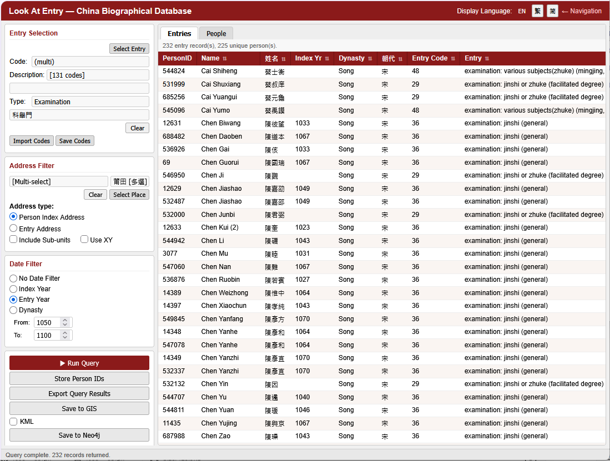
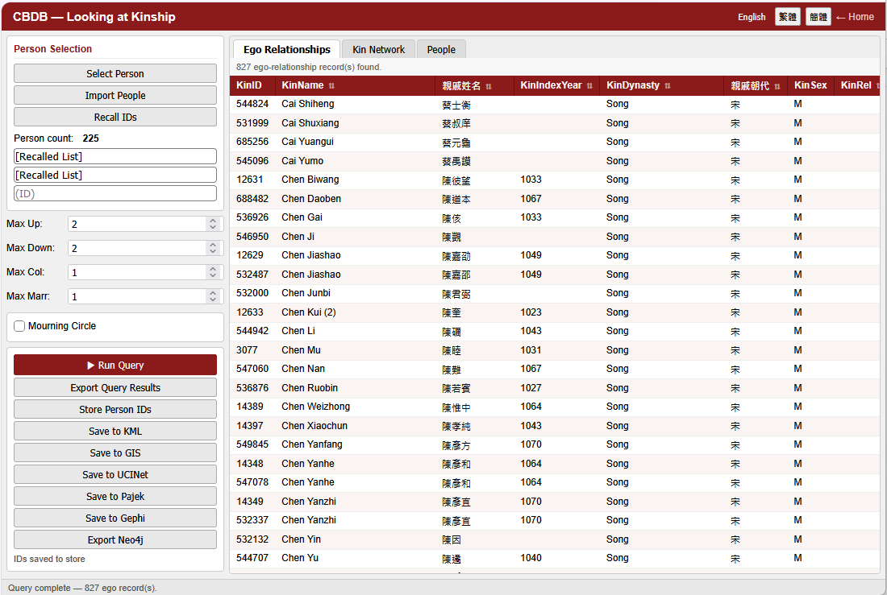
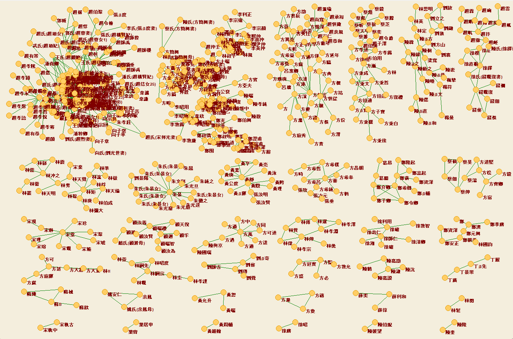
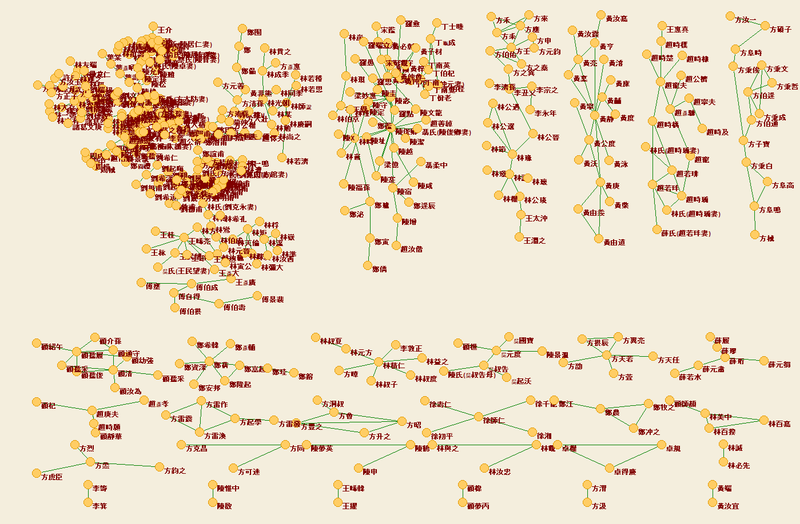

# Chapter 4. Advanced Query Techniques

The CBDB desktop application permits a variety of increasingly complex and powerful approaches to analyzing the data. The first level of advanced query simply is to use the output from one form as the input for a second search. The next step, taken when one has become relatively familiar with the data structures in CBDB, is to use the **Query Builder** form to create free-form queries. As one’s command of the concepts of SQL (Structured Query Language) deepens, one can create ever more sophisticated queries. This chapter considers one example of using the output from CBDB forms as input for other queries and then introduces the basic ideas of SQL and illustrates them through an example that requires two steps in query design.

## A. Kinship Networks for Examination Graduates in Putian, Fujian during the Song {: #a-putian }

One question in the study of social history during the Song dynasty is whether local elites remained stable and controlled access to the cultural resources needed to gain entrance to official status or whether there was in fact social mobility where marginal families managed to join the elite stratum through the educational success of their sons. To explore this question, one can look at the kinship structures for those who entered government service through examinations in localities at different times during the Song and see if there is any change in organization. In our example, we consider Putian in Fujian during two periods: 1050-1100 and 1200-1250. We first use the **Entry** form:

The procedure is:

(1) Use **Select Entry** to choose all types in the category of “Examination” 科舉門.

(2) Set the range of examinations first to 1050-1100. (Here I show 1200-1250.)

(3) Use **Select Place** to choose Putian 莆田 during the Song Dynasty.

(4) Run the Query

(5) Use **Store Person IDs** to copy the IDs of the selected people into a temporary table.

Once you have the table of the IDs of people from Putian who entered government through examination for the specified period, open the form **Kinship** and have the form read the stored table of people for 1050-1100:

Here, the procedure is:

(1) Recall the list of people IDs with the **Recall IDs** command button at the top of the form.

(2) You will get confirmation that the table was correctly recalled when you see “[Recalled List].”

(3) Set the kinship parameters to 2 up, 2 down, 1 collateral, and 1 marriage.

(4) After you run the query, save the results into a **Pajek** file.

(5) Repeat the process for the people from 1200-1250 and create a second Pajek file.

Open your Social Network program and “Draw” the results. In this example we use **Pajek** . The initial layout for visualizing networks in Pajek is “Circular.” A more useful layout for looking at groups of kinship networks is to select “Separate Components” in the “Kamada-Kawai” layout listings. When one select and closely looks at the components of the kinship networks for men from Putian who passed an examination for the years 1050-1100 and 1200-1250, one gets:

Putian Examination Kinship Networks, 1050-1100

Putian Examination Kinship Networks, 1200-1250

Note that by the later period, the “principal component” (the largest component in the network) has grown to include not only a Fang 方, Chen 陳, and Lin 林 clan, but also members of Zheng 鄭 and Gu 顧 clans. The Song 宋 surname largely has disappeared. Since the largest components are “snowballs,” dense networks with many nodes, visualization is of only limited usefulness, and SNA programs like Pajek and Gephi have many analytic tools that can help clarify the transformations in the kinship networks in Putian over the century.

The point of this example in exploring the kinship networks of exam entrants in a specific place was to demonstrate how the sharing of IDs among forms in the CBDB greatly simplifies the study of interactions among dimension of social experience as represented by the CBDB data structures.

